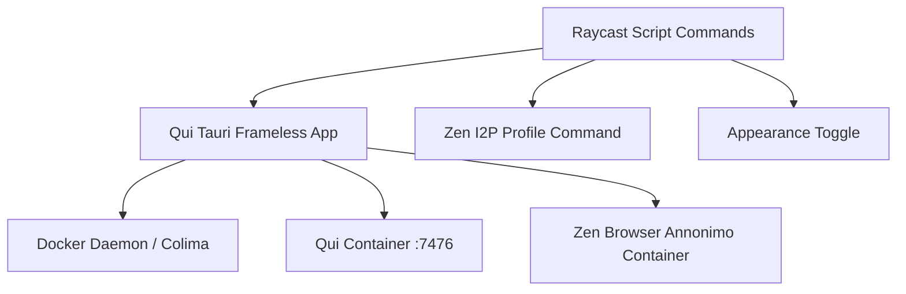

# Docs

Architecture and product wiki for Raycast commands and tools.

**Status legend:** pages mark work as **shipped**, **in progress**, or
**planned**. A page claims only what the code delivers. Decisions that will not
ship live in [Unshipped](product/unshipped.md).

---

## System topology

---

## Index

| Area | Pages |
| ---- | ----- |
| **Architecture** | [Overview](architecture/overview.md) |
| **Product** | [Unshipped](product/unshipped.md) |

---

## Spec catalog

- [`specs/catalog.md`](specs/catalog.md) — business rules and use cases traced
  to tests (`asserted` or `fail-closed`)

---

## Related READMEs

- [`../open-qui/README.md`](../open-qui/README.md)
- [`../open-qui-desktop/README.md`](../open-qui-desktop/README.md)
- [`../qui-app/README.md`](../qui-app/README.md)
- [`../open-i2p-zen-profile/README.md`](../open-i2p-zen-profile/README.md)
