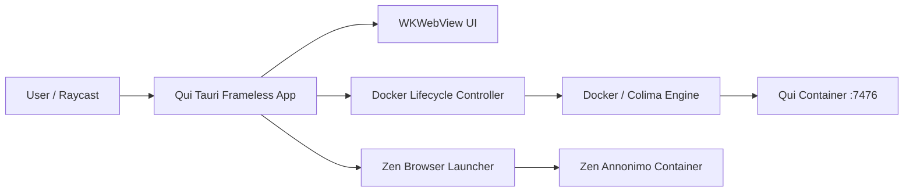

# Architecture Overview

**Status:** shipped

---

## Shape

### Components

1. **Qui Tauri Desktop App (`qui-app/`)**:
   - Built on Tauri v2 (Rust + Webview).
   - Frameless window (`decorations: false`, transparent, native shadow).
   - Clean Docker lifecycle management: pulls updates and launches the container on startup, and automatically stops the container upon window close or quit.
   - Pinned draggable titlebar with macOS window controls, live status badges, reload button, and Zen Annonimo container trigger.

2. **Raycast Commands**:
   - `open-qui`: Ensures the Qui Docker container is running, then opens or focuses the user's **Safari web app**.
   - `open-qui-desktop`: Launches the **Tauri frameless wrapper** (`com.ukvdavi.qui`), which manages Docker while open and opens Zen (Annonimo).
   - `open-i2p-zen-profile`: Opens or focuses Zen Browser with the I2P profile.
   - `toggle-appearance`: Toggles macOS dark/light mode.
