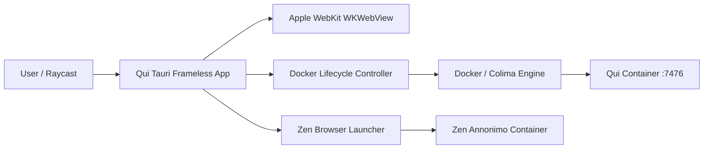

# Architecture Overview

**Status:** shipped

---

## Shape

### Components

1. **Qui Desktop App (`qui-app/`)**:
   - Built on Apple WebKit (`WKWebView`), Tauri v2, and Rust for native performance.
   - Frameless squircle window: continuous curvature (`22px` radius), zero top bar / chrome, translucent glass styling with `-webkit-backdrop-filter` and macOS native acrylic vibrancy.
   - Invisible top drag region and hover-only floating traffic lights.
   - Clean Docker lifecycle management: automatically verifies Colima/Docker, pulls image updates, launches the container on startup, and cleanly stops the container upon window close or quit.
   - Zen Annonimo integration: automatically launches the running Qui dashboard into Zen's `Annonimo` container on readiness.

2. **Raycast Commands**:
   - `open-qui`: Ensures the Qui Docker container is running, then opens or focuses the user's **Safari web app**.
   - `open-qui-desktop`: Launches the **Tauri frameless wrapper** (`com.ukvdavi.qui`), which manages Docker while open and opens Zen (Annonimo).
   - `open-i2p-zen-profile`: Opens or focuses Zen Browser with the I2P profile.
   - `toggle-appearance`: Toggles macOS dark/light mode.
