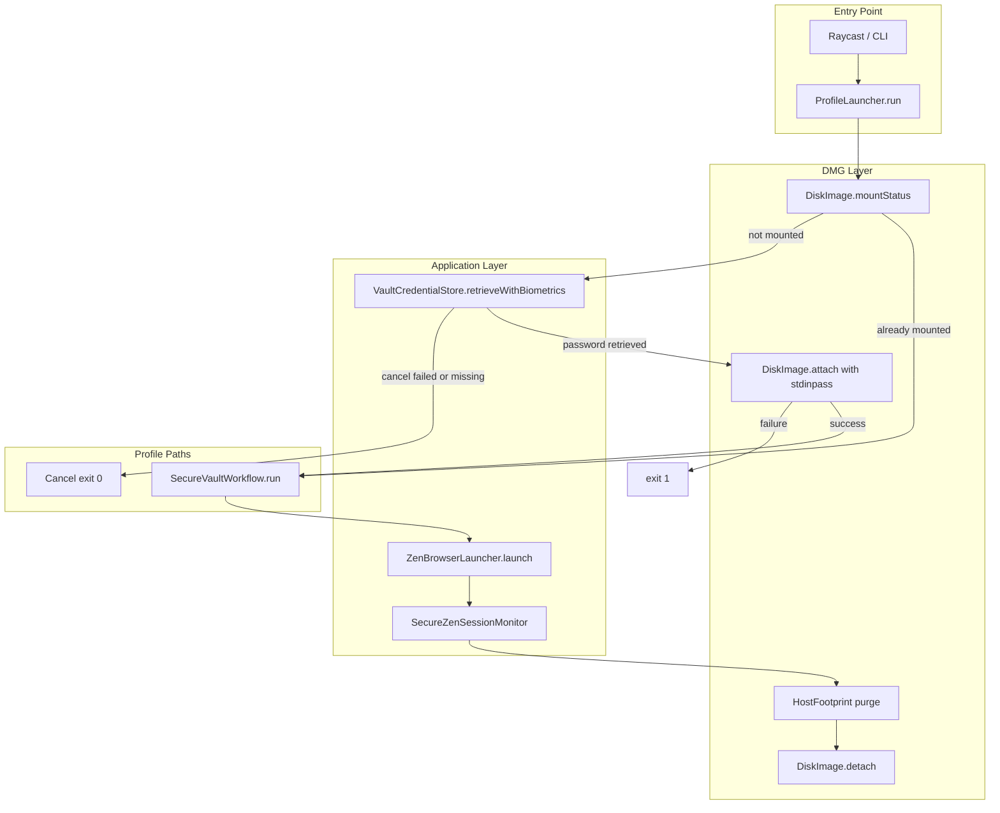
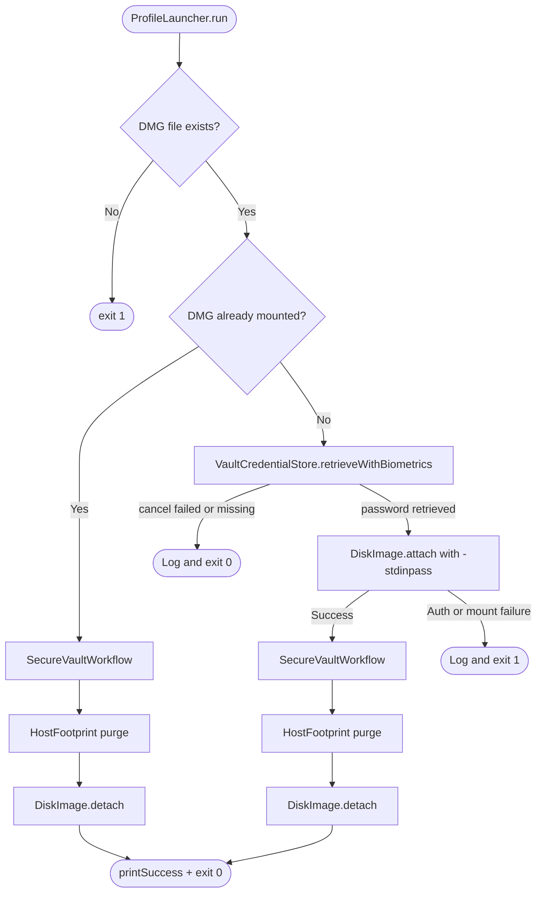
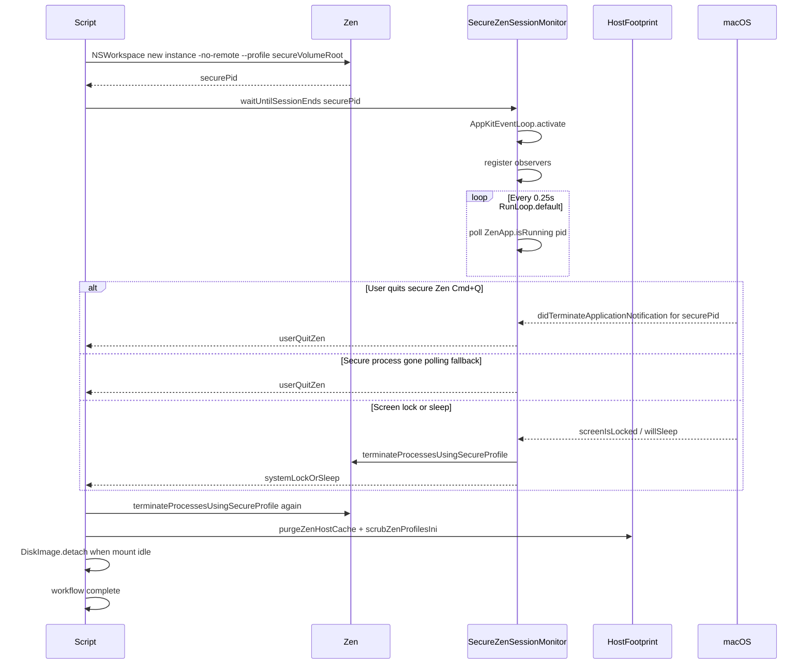
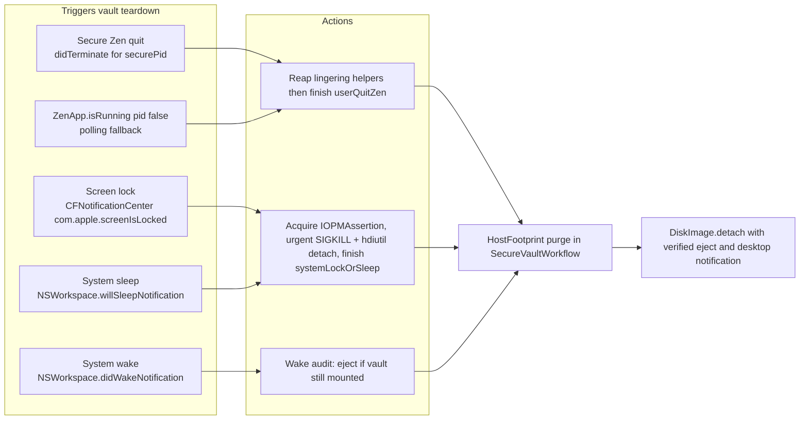
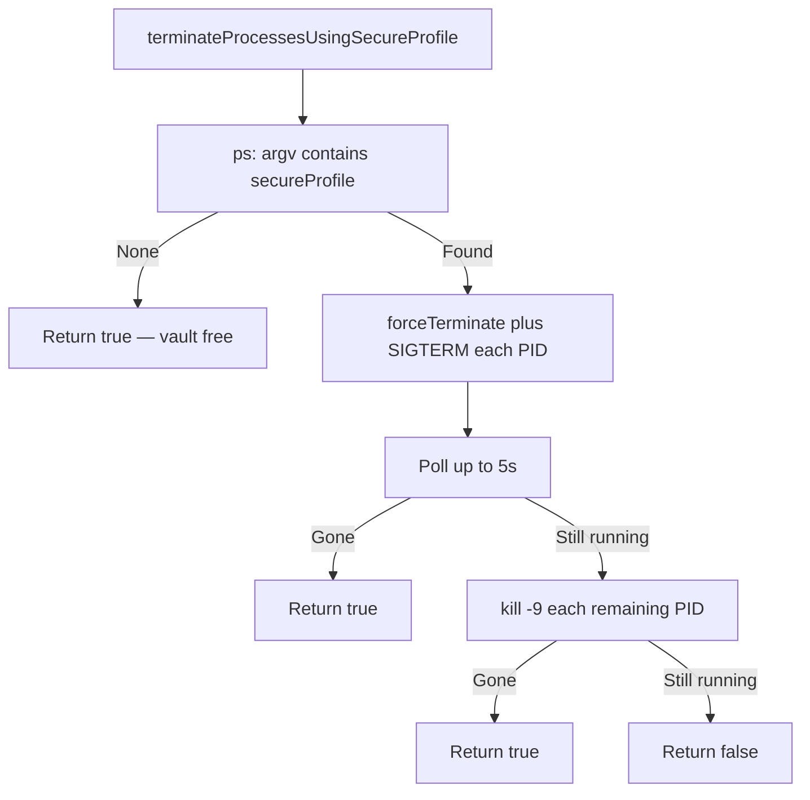
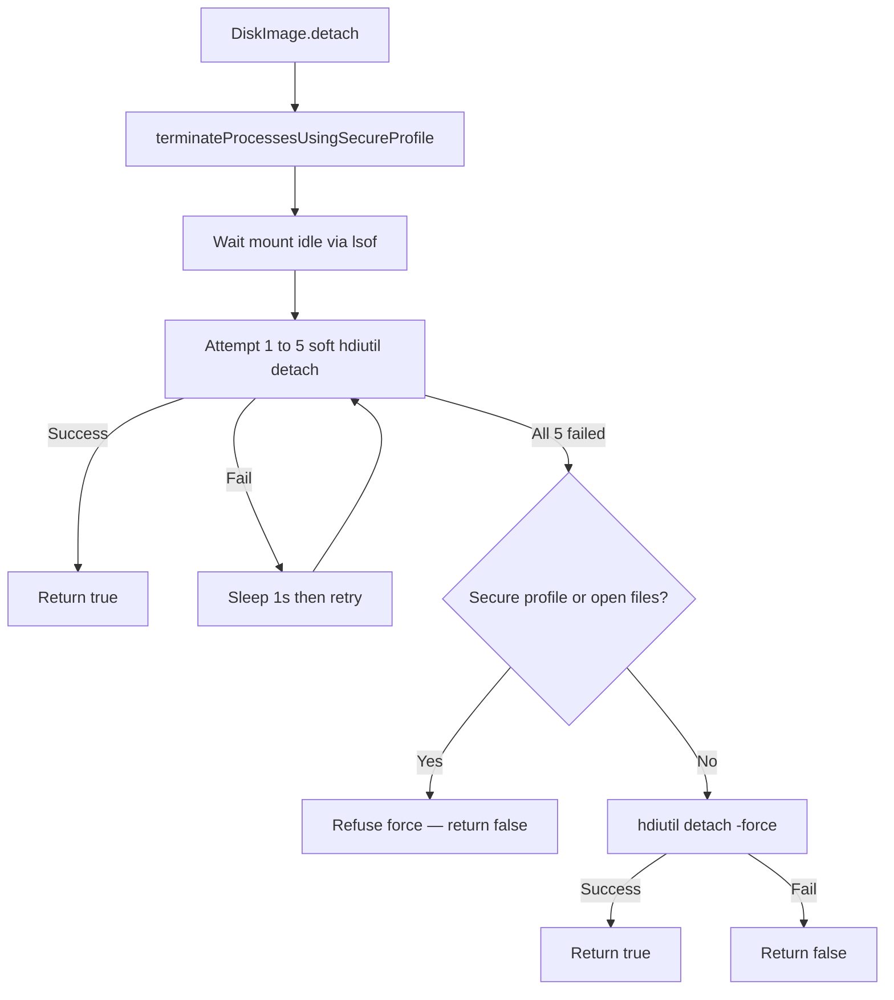

# პროფილი — Zen Secure Profile Launcher

Raycast script that mounts an encrypted DMG vault, launches Zen Browser with a secure profile, monitors the session for security events, and ejects the vault when the session ends.

**Source:** [`პროფილი.swift`](პროფილი.swift)

---

## Overview

| Property            | Value                                 |
| ------------------- | ------------------------------------- |
| Raycast title       | Open Developer                        |
| Raycast description | Open the Developer folder on terminal |
| Mode                | `silent`                              |
| Language            | Swift (`#!/usr/bin/swift`)            |
| Package             | Utilities                             |
| Icon                | `icon.svg`                            |
| Author              | Johann-Goncalves-Pereira              |

The script stays alive in the background while Zen is open on a **secure profile** (mounted DMG). It listens for macOS sleep, screen lock, and Zen quit events, then tears down the session and ejects the encrypted volume.

---

## High-Level Architecture



---

## Main Workflow Decision Tree



---

## Secure Profile Session Lifecycle

The secure vault path always activates `SecureZenSessionMonitor`. There is no personal-profile fallback: Touch ID cancel or a failed mount aborts the script.



---

## SecureZenSessionMonitor — Event Sources



| Event                      | API                                                     | On trigger                                                      |
| -------------------------- | ------------------------------------------------------- | --------------------------------------------------------------- |
| Secure Zen quit            | `NSWorkspace.didTerminateApplicationNotification` matching `securePid` | Wait 1.0s grace period for helpers, reap, finish (`userQuitZen`) |
| Secure Zen gone (fallback) | `ZenApp.isRunning(pid:)` poll every 0.25s               | Finish monitor (`userQuitZen`)                                  |
| Screen lock                | `CFNotificationCenter` → `Zen.screenLockedNotification` | Acquire assertion → urgent `SIGKILL` + `DiskImage.detach(urgent:)` → finish (`systemLockOrSleep`) |
| System sleep               | `NSWorkspace.willSleepNotification`                     | Acquire `IOPMAssertion`, immediate `SIGKILL` + urgent eject under assertion → finish (`systemLockOrSleep`) |
| System wake                | `NSWorkspace.didWakeNotification` (monitor + workflow)  | Safety audit: if vault still mounted, urgent terminate + eject (even after `hasFinished`) |

> **Note:** Security monitoring applies for every Zen session this script launches (`ZenBrowserLauncher.Session.monitoredSecureVault`). Quit/kill of a daily Zen instance does **not** end the secure session.

---

## Configuration

All paths are defined in `Paths` inside [`პროფილი.swift`](პროფილი.swift):

| Constant                 | Path                                                     | Purpose                                            |
| ------------------------ | -------------------------------------------------------- | -------------------------------------------------- |
| `Paths.encryptedVault`   | `~/Library/Application Support/zen/Profiles/Profile.dmg` | Encrypted vault image                              |
| `Paths.zenApp`           | `~/Applications/Zen.app` (fallback `/Applications/Zen.app`) | Zen Browser (home copy preferred for autoconfig) |
| `Paths.secureVolumeRoot` | `/Volumes/.com.apple.zen.framework`                      | Hidden fixed DMG mount point (profile at DMG root) |
| `Paths.secureProfile`    | Same as `secureVolumeRoot`                               | Zen profile path passed to `--profile`             |
| `Paths.zenHostCache`     | `~/Library/Caches/app.zen-browser.zen`                   | Host-side Zen cache purged after secure session    |
| `Paths.zenProfilesIni`   | `~/Library/Application Support/zen/profiles.ini`         | Zen profile registry scrubbed after secure session |

Zen identifiers in `Zen`:

| Constant              | Value                                          |
| --------------------- | ---------------------------------------------- |
| `zenBundleIdentifier` | `Zen.bundleIdentifier` (`app.zen-browser.zen`) |

Keychain identifiers in `VaultCredentialStore`:

| Constant                       | Value                         |
| ------------------------------ | ----------------------------- |
| `VaultCredentialStore.service` | `com.johann.zen.secure-vault` |
| `VaultCredentialStore.account` | `Profile.dmg`                 |

---

## Behavior Reference

### 1. DMG already mounted

- Skips Touch ID.
- Opens Zen with secure profile at `secureVolumeRoot`.
- Monitors session until quit, lock, or sleep.
- Purges host cache and scrubs `profiles.ini`.
- Ejects DMG when session ends (with detach retry).

### 2. Fresh mount — Touch ID happy path

1. Prompts Touch ID via `VaultCredentialStore.retrieveWithBiometrics`. The sheet is biometrics-only (`localizedFallbackTitle` is empty), so **Use Password…** is not offered.
2. Retrieves DMG passphrase from Keychain (Touch ID protected; separate from Mac login password).
3. Runs `hdiutil attach -stdinpass -nobrowse -mountpoint /Volumes/.com.apple.zen.framework` — no password dialog.
4. Opens Zen with secure profile.
5. Monitors session.
6. Purges host cache and scrubs `profiles.ini`.
7. Ejects DMG when session ends (with detach retry).

### 3. Touch ID cancelled, failed, unavailable, or not configured

When Touch ID is cancelled, fails, is unavailable, or the vault password is not in Keychain:

1. Logs `Touch ID cancelled — aborting`.
2. Calls `exit(0)` so Raycast silent mode does not show an error toast.
3. Does not mount the DMG, does not open Zen, does not open Proton Pass.

### 4. Mount cancelled / wrong password

- Detects auth errors in `hdiutil` output (`Authentication_Canceled`, `cancelled`, etc.).
- Logs the failure and calls `exit(1)`.
- Does not fall back to an interactive password prompt or a personal profile.

### 5. Mount failure (non-auth)

- Prints error and calls `exit(1)`.

### 6. DMG file missing

- Prints error and calls `exit(1)` before any mount attempt.

### 7. Zen manual quit (secure session)

- `SecureZenSessionMonitor` detects quit of the **secure PID** via notification or polling (other Zen processes are ignored).
- Prints `Zen Browser operation completed successfully.`
- Prints `Zen session ended. Purging host footprint...`
- Removes `~/Library/Caches/app.zen-browser.zen` and scrubs secure entries from `profiles.ini`.
- Prints `Ejecting vault...`
- Runs `hdiutil detach` (up to 3 attempts, 1s apart; `-force` fallback).

### 8. Screen lock or sleep (secure session)

- Monitor receives lock/sleep event.
- Prints `System sleep/lock detected — securing vault...`
- Terminates **every process whose argv contains the secure profile path** (`SIGTERM` then `kill -9`). Daily Zen (other profile) is left alone.
- Waits until those processes are gone before purge/eject.
- Prints `Vault secured due to system sleep or lock.`
- Purges host cache and scrubs `profiles.ini`.
- Ejects DMG (with detach retry). Never force-unmounts while the vault is still held — that would SIGBUS-crash Zen (`backing vnode was force unmounted`).

### 9. Zen already running at start (daily browser)

- Launches a **new** Zen process with `NSWorkspace` `createsNewApplicationInstance` and `-no-remote --profile <securePath>`.
- Records the returned `processIdentifier` and scopes monitoring/kill to that PID.
- Existing daily Zen windows keep running; lock/sleep during the secure session does not kill them.

### 10. Hidden mount point (OpSec)

- DMG mounts at `/Volumes/.com.apple.zen.framework` (dot-prefixed, hidden in Finder).
- `ps aux` shows a generic system-looking `--profile` path instead of `Profile Secure` / `j3wki3fc.Secure`.
- Profile files live at the DMG root (not in a subfolder).

### 11. ActivityWatch — exclude encrypted Zen only

While the secure session is open, `ActivityWatchEncryptedZenFilter` runs inside `SecureZenSessionMonitor`:

- When **encrypted Zen** is frontmost, recent `aw-watcher-window` events with `app == Zen` are deleted via the local ActivityWatch API (`http://127.0.0.1:5600`, override with `ACTIVITYWATCH_URL`).
- **Daily Zen** and every other app keep recording (the window watcher is never paused). Trailing scrub is timestamp-capped so the first seconds of daily Zen after you switch away are kept.
- Synced/remote buckets are not touched.
- If ActivityWatch is down, scrubbing is skipped silently.
- Do **not** install the ActivityWatch web extension on the encrypted profile; this filter only scrubs the window watcher.

### 12. One-time vault password setup (`--store-vault-password`)

Store the DMG encryption password in Keychain, protected by Touch ID:

```bash
pbpaste | ./პროფილი.swift --store-vault-password
```

Copy the vault password first (for example from Proton Pass), then run the command above. The password is stored under `VaultCredentialStore.service` / `VaultCredentialStore.account` with `kSecAttrAccessibleWhenUnlockedThisDeviceOnly`. Touch ID is enforced on every read via `LAContext` (required for unsigned Raycast/CLI scripts — item-level `SecAccessControl` biometry needs code signing entitlements).

**Security notes:**

- Vault passphrase is separate from your Mac login password; Touch ID is required before each Keychain read. The prompt hides the device-password fallback (`LAContext.localizedFallbackTitle = ""`).
- Uses the file-based Keychain (`kSecUseDataProtectionKeychain: false`) so the script can run without app entitlements.
- Item is device-only, not iCloud-synced.
- The script never launches Proton Pass. If Touch ID fails, the run is cancelled.

---

## Process Kill Strategy



Never uses `pkill -x Zen`. Session liveness and kill targets are **profile-path** based so daily Zen stays up and helpers holding the vault are included.

## DMG Detach Strategy

Force-unmounting while Zen still has mmap'd profile files causes `EXC_BAD_ACCESS (SIGBUS)` / `backing vnode was force unmounted`. Detach never force-unmounts under a live vault holder.



---

## Logging Conventions

| Prefix | Function      | Meaning                      |
| ------ | ------------- | ---------------------------- |
| 🔧     | `Log.status`  | Informational step           |
| ✅     | `Log.success` | Successful operation         |
| ❌     | `Log.error`   | Error (may or may not abort) |

Raycast `silent` mode surfaces this output in the Raycast log / terminal when run via CLI.

---

## Dependencies & Requirements

- **macOS** with `hdiutil`, `kill`, `ps`, `lsof`
- **Zen Browser** at `~/Applications/Zen.app` (falls back to `/Applications/Zen.app`)
- **Encrypted DMG** at the configured `dmgPath`
- **AppKit** — imported for `NSWorkspace`, `NSRunningApplication`, run loop, and screen-lock notifications
- **LocalAuthentication** — Touch ID prompt for Keychain vault unlock
- **Security** — Keychain storage and retrieval of DMG passphrase
- **Touch ID** Mac (cancelled or unavailable biometry aborts the run)
- Script must **remain running** for the full secure session (Raycast waits until the script exits)

### Run loop constraint

The monitor uses `RunLoop.main.run(mode: .default, before:)` — **not** `.common`. Using `.common` as a run mode causes a CFRunLoop error and breaks event delivery.

---

## Manual Testing Checklist

| Scenario                                                            | Expected result                                                                               |
| ------------------------------------------------------------------- | --------------------------------------------------------------------------------------------- |
| One-time setup: `pbpaste \| ./პროფილი.swift --store-vault-password` | Vault password stored in Keychain (Touch ID protected), exits 0                               |
| Touch ID mount happy path                                           | Touch ID prompt with no Use Password option → mount via `-stdinpass` → Zen secure profile     |
| Cancel Touch ID                                                     | Logs abort and exits 0; no mount, no Zen, no password dialog                                  |
| Touch ID unavailable / password not in Keychain                     | Same as cancel: abort, exit 0                                                                 |
| Wrong stored Keychain password                                      | Mount fails, script exits 1                                                                   |
| Mount DMG → use Zen → Cmd+Q                                         | Lingering helpers reaped; DMG cleanly ejects; desktop notification displayed; exits 0         |
| Already-mounted DMG path                                            | Skips Touch ID, monitors, purges footprint, ejects on quit                                    |
| Lock screen (⌃⌘Q) during secure session                             | Secure PID killed only; daily Zen stays; footprint purged; DMG ejected; notification shown     |
| Close lid / sleep during secure session                             | IOPMAssertion holds sleep; urgent SIGKILL + detach under assertion before sleep; no leftover mount |
| Wake machine after sleep                                            | didWake + workflow wake audit eject leftover mounts if sleep raced teardown                  |
| Daily Zen already open → run პროფილი                                | Second Zen process with secure profile; daily Zen stays                                       |
| Quit daily Zen during secure session                                | Secure session continues; monitor does not end early                                          |
| Cmd+Q only the secure window                                        | Session ends, vault ejects; daily Zen stays; notification confirms ejection                   |
| Missing DMG file                                                    | Script displays error notification and exits with code 1                                      |
| Quick Cmd+Q after browsing                                          | Detach retry succeeds despite busy resource; notification shown                               |
| Detach failure fallback                                             | Forced detach executes; if failed, loud warning notification shown and script exits 1        |
| After secure session                                                | `~/Library/Caches/app.zen-browser.zen` removed; no `.com.apple.zen.framework` in profiles.ini |
| `ps aux` during secure session                                      | Shows `/Volumes/.com.apple.zen.framework`, not `Profile Secure`; two Zen PIDs if daily open   |
| Run from CLI: `./პროფილი.swift`                                     | Same behavior as Raycast                                                                      |

---

## File Structure (code map)

```
პროფილი.swift
├── Paths / Zen / SystemPaths          — paths and identifiers
├── Log / DesktopNotification          — logging and Notification Center alerts
├── PowerManagement                    — IOKit sleep prevention assertions
├── FileSystem                         — filesystem helpers
├── ProcessRunner                      — shell command execution
├── DiskImagePlist models              — hdiutil plist parsing
├── DiskImage                          — attach, detach, mount status
├── HostFootprint                      — cache purge + profiles.ini scrub
├── AppKitEventLoop                    — CLI notification bootstrap
├── VaultCredentialStore               — Touch ID Keychain store/retrieve
├── VaultCredentialSetup               — --store-vault-password CLI mode
├── ZenApp                             — process lifecycle and mount inspection
├── SecureZenSessionMonitor            — sleep / wake / lock / quit monitoring
├── ZenBrowserLauncher                 — open Zen (monitored session)
├── SecureVaultWorkflow                — secure profile + verified eject
└── ProfileLauncher                    — entry orchestrator
```

---

## Maintaining This Document

**Update [`README.md`](README.md) whenever you change [`პროფილი.swift`](პროფილი.swift).** Treat the README as part of the same change — do not merge script changes without updating the docs.

### When to update

| Change in script                                     | Sections to update                                       |
| ---------------------------------------------------- | -------------------------------------------------------- |
| New/removed path in `Paths`                          | Configuration table                                      |
| New workflow branch in `ProfileLauncher`             | Main Workflow Decision Tree diagram + Behavior Reference |
| New monitor event or removed observer                | SecureZenSessionMonitor diagram + Event Sources table    |
| Changed kill/eject/mount logic                       | Process Kill Strategy + relevant behavior item           |
| New Raycast metadata comments                        | Overview table                                           |
| Changed `ZenBrowserLauncher.Session` / profile logic | Secure Profile Session Lifecycle + Behavior Reference    |
| New exit codes or error handling                     | Behavior Reference + Testing Checklist                   |
| Renamed functions or restructured MARK sections      | File Structure code map                                  |

### Update checklist

1. Read the full diff of `პროფილი.swift`.
2. Identify which behaviors, paths, or events changed.
3. Update the affected **diagrams** (mermaid blocks must use valid syntax: no spaces in node IDs, no HTML in labels).
4. Update the **tables** and **behavior list** to match the new logic exactly.
5. Add or remove **test scenarios** if behavior changed.
6. Verify diagrams still reflect the real call order (especially `SecureVaultWorkflow` → `ZenBrowserLauncher` → `SecureZenSessionMonitor` → `HostFootprint` → `DiskImage.detach`).

### Diagram rules used here

- `flowchart` for decision trees and architecture.
- `sequenceDiagram` for time-ordered secure session flow.
- Node IDs use camelCase without spaces (e.g. `CheckMounted`, not `Check Mounted`).
- Edge labels use `\n` for line breaks inside node text where needed.

### Quick validation after edits

```bash
# Typecheck the script
swiftc -typecheck პროფილი.swift \
  -framework AppKit -framework Foundation \
  -framework LocalAuthentication -framework Security

# One-time Keychain setup (copy the vault password onto the clipboard first)
pbpaste | ./პროფილი.swift --store-vault-password

# Run manually and walk through the testing checklist above
./პროფილი.swift
```

If a diagram no longer matches a function name or flow in the source file, the README is out of date — fix it before considering the change complete.
